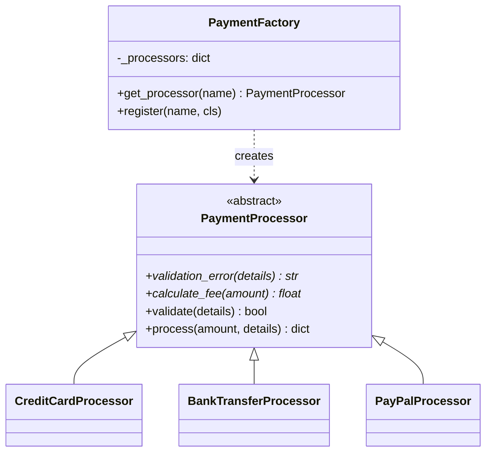
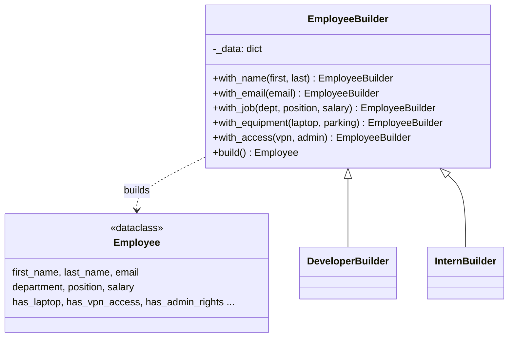
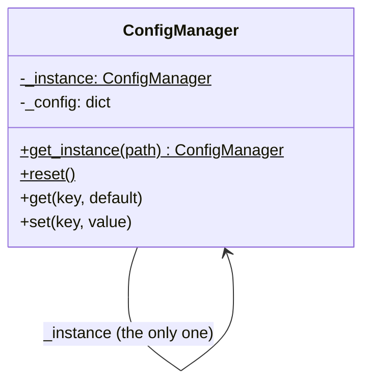
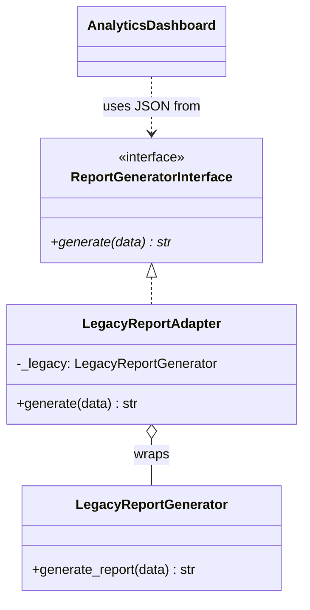
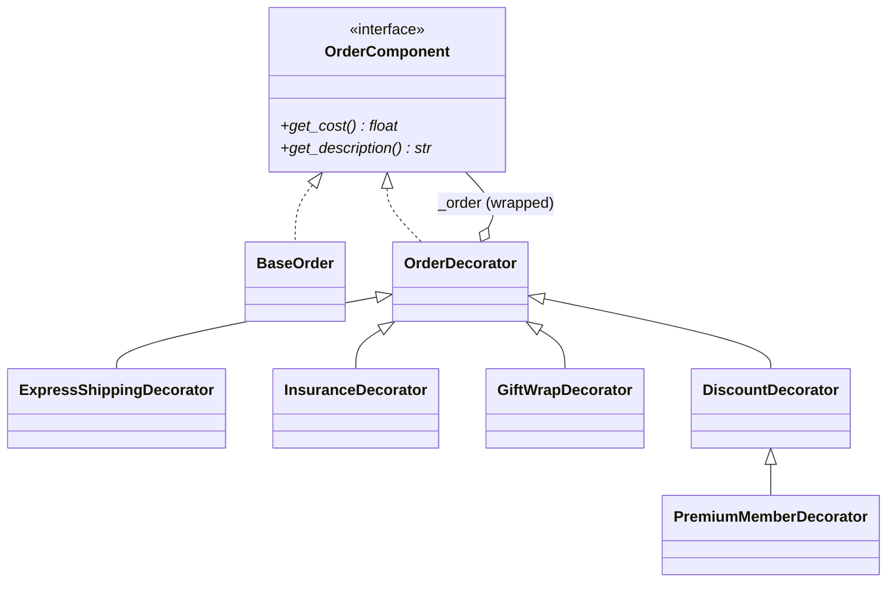
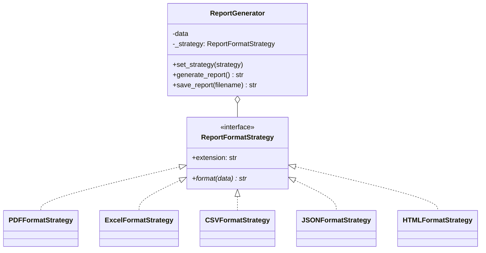
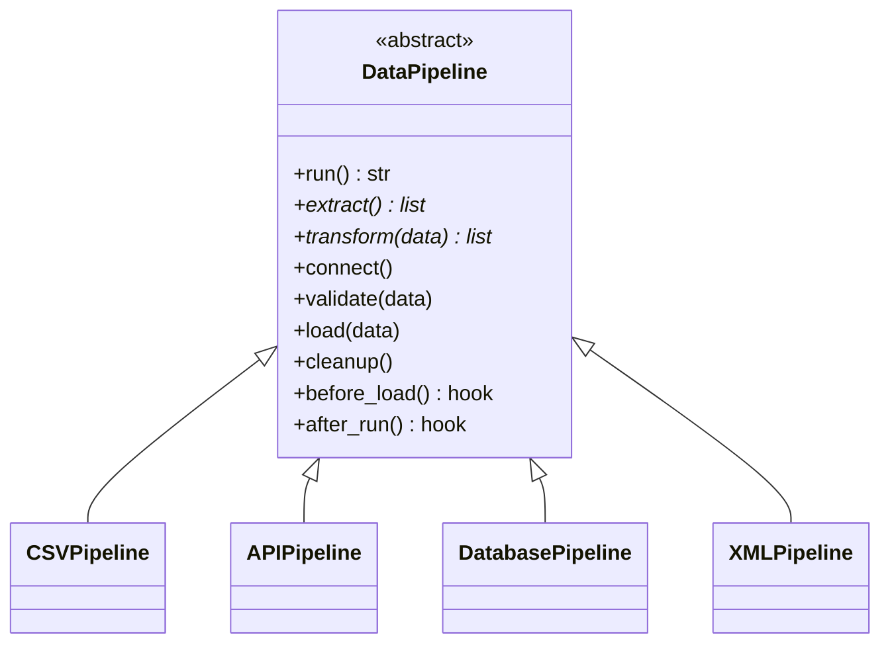

# Exercise 5 (slide 84): Design patterns in practice

**Statements:** [creational](https://courses.dallard.tech/sys_design/creational_pattern/) · [structural](https://courses.dallard.tech/sys_design/structural_pattern/) · [behavioral](https://courses.dallard.tech/sys_design/behavioral_pattern/)

7 refactoring exercises: each one starts from "spaghetti" code and turns it into a pattern.
Every file runs on its own (`python3 creational/factory_payment.py`) and **51 tests** check them all:

```bash
cd design-pattern-in-practice
pip install pytest pytest-mock
pytest
```

| Family | Pattern | Exercise | File |
| --- | --- | --- | --- |
| Creational | Factory Method | Payment system | [`creational/factory_payment.py`](creational/factory_payment.py) |
| Creational | Builder | HR employee onboarding | [`creational/builder_employee.py`](creational/builder_employee.py) |
| Creational | Singleton | Configuration manager | [`creational/singleton_config.py`](creational/singleton_config.py) |
| Structural | Adapter | XML report into a JSON dashboard | [`structural/adapter_report.py`](structural/adapter_report.py) |
| Structural | Decorator | Order pricing options | [`structural/decorator_order.py`](structural/decorator_order.py) |
| Behavioral | Strategy | Report formats | [`behavioral/strategy_report.py`](behavioral/strategy_report.py) |
| Behavioral | Template Method | ETL data pipelines | [`behavioral/template_etl.py`](behavioral/template_etl.py) |

The course says **"draw the UML before coding"**, so each section starts with its class diagram (GitHub draws them for you).
On paper: hollow triangle arrow = inheritance, dashed arrow = dependency / "uses", diamond = has-a (filled = composition, hollow = aggregation), *italics* or `<<abstract>>` = abstract.

---

## The 3 families in one sentence each

- **Creational**: *how objects are created* (who calls the constructor, and with what).
- **Structural**: *how objects are put together* (wrapping, adapting, combining).
- **Behavioral**: *how objects share the work* (who decides what, and when).

---

## 1. Factory Method: payment system

**Smell:** one `process_payment()` with an `if/elif` per payment type. Adding Apple Pay means editing a function that already works, which breaks the **Open/Closed principle**.

**Idea:** one class per payment type, all following the same abstract interface. A factory turns a string into the right object, using a **dictionary** instead of an `if` chain.



**Key points**
- `process()` is written **once** in the abstract class: validate, then fee, then result. Subclasses only give their rules (fee and validation).
- `PaymentFactory.register("apple_pay", ApplePayProcessor)` adds a method **without editing any existing line** (demo at the bottom of the file).
- Trying `PaymentProcessor()` raises `TypeError`: an abstract class cannot be instantiated.

## 2. Builder: employee onboarding

**Smell:** `create_employee()` takes 17 positional arguments (a "telescoping constructor"). Forget one `None` and every following value shifts. And what does `False, True, True` even mean?

**Idea:** a simple `Employee` data class (the product) and an `EmployeeBuilder` whose small methods each **return `self`**, so calls chain like a sentence. Validation happens once, in `build()`.



**Key points**
- `.with_access(vpn=True, admin=True)`: keyword names make every value self-explaining.
- **Presets** fix the "hidden logic" smell: `DeveloperBuilder` *always* gives laptop, VPN and admin rights.
- `@dataclass` auto-writes `__init__`, `__repr__` and `__eq__` (slide 39).

## 3. Singleton: configuration manager

**Smell:** every module calls `load_config()`, so `config.json` is read 4 times per request, each module has its own copy, and changes are not shared.

**Idea:** one shared object. `ConfigManager.get_instance()` creates it the first time and returns **the same object** afterwards.



**Key points**
- `_instance` is a **class attribute**, shared by the whole program; `get_instance` is a `@classmethod` (slide 87: "use @classmethod for factory methods").
- `get("database.host")` walks the nested dict by splitting on dots.
- `reset()` exists for tests, so each test starts fresh (otherwise tests leak state into each other, the classic Singleton downside).
- Calling `ConfigManager()` directly when one exists raises an error.

---

## 4. Adapter: XML reports into a JSON dashboard

**Smell:** the legacy generator (which we **can't modify**) returns XML, and the new dashboard only reads JSON. Each function did its own "conversion", and actually cheated by re-using the original dict.

**Idea:** like a travel plug adapter. `LegacyReportAdapter` **implements the new interface** (`generate() -> JSON`), and inside it **calls the old object** and translates the result.



**Key points**
- The adapter uses **composition** (it *has* a legacy object) rather than inheritance: "prefer composition over inheritance" (slide 87).
- The conversion is real: it parses the XML with `xml.etree.ElementTree` and turns `"150000"` back into the number `150000`.
- One test swaps the legacy object for a **Mock** to prove the adapter really calls it (exercise 6 skills!).

## 5. Decorator: order pricing

**Smell:** `calculate_total()` with 5 boolean flags. Every new option means another parameter and another `if`, and the order of operations is hidden.

**Idea:** start with a `BaseOrder`, then wrap it in layers. Each decorator **is** an `OrderComponent` and **has** an `OrderComponent`. It adds its own cost and passes the rest to the order it wraps.



**Key points**
- The **order of the layers now matters, and you can see it**: a discount wrapped *after* shipping also discounts the shipping. There's a test that proves it (`test_layer_order_matters`).
- To give exactly the legacy total (95.625€), insurance is wrapped first, so it is 5% of the base price.
- `PremiumMemberDecorator` is just a 10% `DiscountDecorator`, so it reuses that class through inheritance.
- Don't confuse this with Python's `@decorator` syntax. Same idea (wrap something to add behaviour), but Python's version wraps **functions**, and this pattern wraps **objects**.

---

## 6. Strategy: report formats

**Problems in the original** (the exercise asks you to list them):
1. Adding XML or Markdown means editing **two** `if/elif` chains, which breaks Open/Closed.
2. The list of formats is duplicated in `generate_report` and `save_report`.
3. You can't test one format alone.
4. Formats are raw strings, so a typo like `"pfd"` silently returns "Unknown format".

**Idea:** each format becomes a **strategy** class. The `ReportGenerator` (the **context**) holds one strategy and can swap it at runtime with `set_strategy()`.



**Final test from the exercise:** `HTMLFormatStrategy` was added **without touching any other class**, which proves the design is extensible.
Each strategy also knows its own file `extension`, so `save_report` needs no `if` at all.

Slide 86 rule: *"a lot of if/elif statements → Strategy"*.

## 7. Template Method: ETL pipelines

**Problems in the original:**
1. Validate, load and cleanup are copy-pasted 3 times (more than half the code).
2. Adding logging to all pipelines means editing 3 classes.
3. Changing the order of steps means editing 3 classes, and they can drift apart.
4. Nothing forces a new pipeline to validate its data.

**Idea:** the abstract base class owns `run()`, the **template method** that fixes the order of steps. Subclasses fill in only the steps that differ (`extract`, `transform`). **Hooks** (`before_load`, `after_run`) are optional steps that do nothing unless a subclass overrides them.



**Key points**
- `DatabasePipeline` uses the `before_load` hook ("Opening database transaction"); the others don't need to.
- The new `XMLPipeline` (the exercise's validation step) is only about 20 lines: extraction and transformation.
- **Template Method vs Strategy:** Template Method uses **inheritance** (subclasses fill in steps of a fixed algorithm). Strategy uses **composition** (swap the whole algorithm object at runtime).

---

## Check yourself (exam style)

1. Which pattern fits each situation? (a) many `if/elif` on a "type" string choosing an algorithm; (b) a third-party class with the wrong interface; (c) a constructor with 15 parameters; (d) you need exactly one database connection pool; (e) three classes copy the same 6-step method.
2. What does it mean that a class is "open for extension, closed for modification"? Show it with the Factory exercise.
3. Why does every `with_*` method of a Builder `return self`?
4. In the Decorator exercise, why is a decorator *both* an `OrderComponent` *and* holding one?
5. Template Method vs Strategy: which uses inheritance, which uses composition?
6. Give one drawback of the Singleton pattern.

<details>
<summary>Answers</summary>

1. (a) Strategy (or Factory if it's about *creating* objects); (b) Adapter; (c) Builder; (d) Singleton; (e) Template Method.
2. You can add behaviour (new payment type) by adding new code (a new class + `register`) without modifying code that already works (`process`, the factory, the other processors).
3. So the calls can be chained: `builder.with_name(...).with_email(...).build()`.
4. Being an `OrderComponent` lets it be used anywhere an order is expected (even wrapped again); holding one lets it delegate to the order inside and add only its own part.
5. Template Method uses inheritance; Strategy uses composition.
6. It is global state: tests can leak into each other (hence `reset()`), and hidden dependencies make code harder to follow.

</details>
